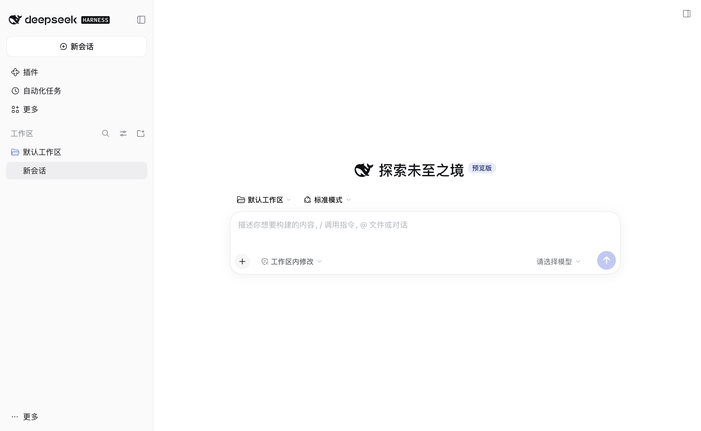
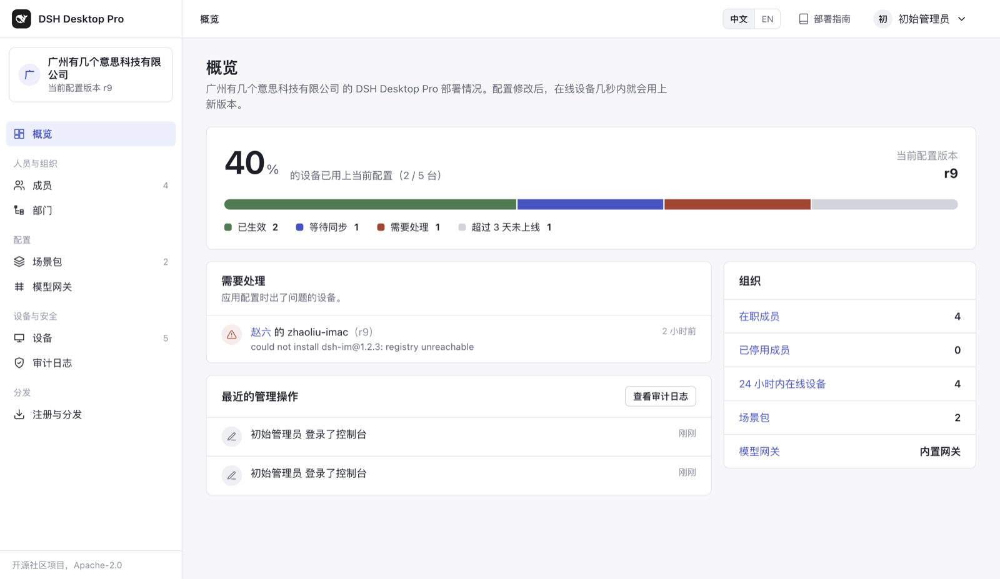

# DSH Desktop Pro

中文 | [English](README_EN.md)

**DeepSeek Harness（`dsh`）的专业版桌面客户端，主打企业级配置。个人装好就能用；在公司里，IT 统一配置模型、插件、Skill 和工具权限，员工登录后即可开始工作。**

> [!IMPORTANT]
> **这是社区维护的非官方项目。** 本项目不是 DeepSeek 官方产品，也不代表 DeepSeek。`DeepSeek`、`DeepSeek Harness`、`dsh` 及相关名称和标识归各自权利人所有。



客户端直接加载官方 Web UI，安装包内置固定版本的官方 `@deepseek-ai/dsh` 运行时，不需要另装 Node.js 或 `dsh` CLI。客户端在此基础上负责运行时管理、托盘、通知、更新和安全控制；企业版能力由客户端和开源的管理服务端共同提供。

## 安全、协作、便捷

**安全**

- 员工电脑上只有个人 Key，公司模型服务的真实 Key 只保存在管理服务端。
- 员工停用后，个人 Key 立即失效，设备上的企业配置自动清除。
- IT 可以禁用指定工具，被禁用的工具不会提供给模型；调用被拦下时会记入审计日志。
- 审计日志逐条串联校验，被改动或删除的记录可以被发现。
- 下发给客户端的配置带签名，客户端校验后才应用；更新包安装前校验 SHA-256。
- Electron 窗口启用沙箱和上下文隔离，并限制页面导航与权限。

**协作**

- 按全员、部门或个人下发「场景包」：模型、插件订阅、Skill 和工具权限打包在一起。
- 配置修改后，在线设备几秒内应用新版本。
- 控制台显示每台设备是否已应用当前配置，以及出错的设备和原因。
- 按成员、部门和模型查看请求数、Token 和费用，可以导出明细给财务对账。
- 给全公司、部门和个人设置费用或 Token 额度；用完后拦截，或改用便宜的模型继续。
- IT 审核过的插件上架到公司插件市场，员工在「发现」页最前面看到；有风险的插件一键禁用，所有电脑都会卸载。
- 公司的 Skill 集中放在 Skill 库：可以给所有人装上，也可以让员工在客户端里自己选装。
- 控制台支持中文和英文。

**便捷**

- 员工安装客户端，用公司账号登录一次，模型和插件就已配置好。
- IT 也可以只放一个配置文件，不部署服务端。
- 关闭窗口后继续在后台运行，可从托盘或菜单栏重新打开。
- 首次启动自动订阅一份精选插件列表，在「发现」页浏览和安装。
- IT 允许时，员工可以在企业模式和个人模式之间切换。

## 个人与企业两种用法

| | 个人使用 | 企业使用 |
|---|---|---|
| 怎么开始 | 安装后填入自己的 API Key | IT 下发配置，员工用公司账号登录 |
| 模型 | 自己的 DeepSeek 或其他模型账号 | 公司模型网关，每人一个个人 Key |
| 插件与 Skill | 自己安装 | IT 统一下发，个人也可以另装 |
| 数据目录 | `~/.dsh` 或客户端独立目录 | 独立的企业目录，不碰个人 `~/.dsh` |
| 需要部署 | 不需要 | 一个配置文件，或管理服务端（Docker Compose） |

没有企业配置的电脑，行为和个人使用完全一样。

## 企业功能



- **文件模式**：把一份 `managed.json` 放到系统目录，员工打开客户端就能用公司的模型网关，插件订阅、Skill 和工具禁用一并生效。配置文件可以签名防篡改。
- **服务端模式**：部署开源的管理服务端（Docker Compose + PostgreSQL），员工用公司 SSO（任意 OpenID Connect）登录。
- **模型网关**：服务端自带网关，对接任意 OpenAI 兼容接口，可以接多个上游；也可以改用 LiteLLM。
- **模型目录、用量与额度**：登记模型和价格，按成员、部门、模型分析用量和费用，按全公司、部门或个人设置额度。
- **插件市场与 Skill 库**：从公开插件索引挑选并审核插件，固定版本上架给员工；集中编辑公司的 Skill，按全员或自选下发。
- **管理控制台**：管理成员、部门、场景包和设备，查看用量和审计日志，生成员工安装用的注册文件。

部署步骤见[企业部署指南](docs/enterprise.zh.md)。

## 路线图

下面是规划方向，尚未提供；实际发布内容以 [CHANGELOG](CHANGELOG.md) 为准。

- **可视化**：配置分发进度、设备状态和用量的更多图表，可以自定义看板。
- **审计**：记录更多类型的事件，支持按人、设备和操作筛选，以及导出审计记录。
- **企业内知识共享**：员工在客户端里把自己写的 Skill 提交到公司 Skill 库，审核后同事直接安装使用。
- **登录与组织同步**：对接飞书、钉钉、企业微信的登录和通讯录。

## 下载安装

从 [GitHub Releases](https://github.com/bruc3van/dsh-desktop-pro/releases) 下载对应系统的安装包。发布版已经包含官方 dsh 运行时，首次启动不会执行 npm 安装。

| 你的设备 | 选择的安装包 |
|---|---|
| macOS，Apple Silicon（Apple M 系列） | `mac-arm64.dmg` |
| macOS，Intel | `mac-x64.dmg` |
| Windows，Intel/AMD 64 位 | `win-x64.exe` |
| Linux，Intel/AMD 64 位 | `linux-x86_64.AppImage` |
| Ubuntu 24.04，Intel/AMD 64 位安装版 | `linux-amd64.deb` |

表中列出文件名后缀，实际文件名还包含客户端版本号。Linux 的安装步骤和系统要求见[使用指南](docs/user-guide.zh.md#linux-x64-安装)。

macOS/Windows 安装包尚未完成正式开发者签名认证，首次打开时系统可能拦截：

- **macOS**：将应用拖入“应用程序”并打开。然后前往“系统设置 → 隐私与安全性”，点击“仍要打开”。如果系统提示“已损坏，无法打开”且没有“仍要打开”按钮，在终端执行：

  ```sh
  xattr -dr com.apple.quarantine "/Applications/DSH Desktop Pro.app"
  ```

- **Windows**：在 Microsoft Defender SmartScreen 中点击“更多信息”，再点击“仍要运行”。

## 开始使用

**个人使用**

1. 首次启动时输入 API Key，或选择“稍后配置”。没有 Key 时，可在 <https://platform.deepseek.com/api_keys> 创建；账户、余额和费用由 DeepSeek 开放平台管理。
2. 根据需要选择 Agent 预设或模型。
3. 添加并选择项目文件夹，作为会话的工作区。
4. 新建会话并发送任务。

> [!TIP]
> 全新数据目录可能默认显示英文。可在 **Settings → General → Language** 中切换语言。

**企业员工**

IT 放好配置后，打开客户端会显示「登录 公司名」。点击后在系统浏览器里完成公司账号登录，回到客户端就能直接使用公司配置好的模型和插件。

## 文档

- [使用指南](docs/user-guide.zh.md)：连接方式、数据与安全、后台运行与更新、内置运行环境、预置插件订阅。
- [企业部署指南](docs/enterprise.zh.md)：文件模式、服务端部署、模型网关、控制台和 SSO。
- [桌面客户端架构](docs/desktop-client-architecture.zh.md)：进程模型、信任边界和设计取舍。
- [开发指南](docs/development.zh.md)：从源码运行、验证和发布。

## 常见问题

**Q：个人用户能用吗？**

能。没有企业配置时，客户端就是一个完整的个人桌面客户端，不需要部署任何服务。

**Q：企业模式会读取或改动我的个人数据吗？**

不会。企业模式使用独立的数据目录，不读写个人的 `~/.dsh`。切回个人模式后，个人的会话和插件都还在。

**Q：这是浏览器套壳吗？**

窗口加载官方 Web UI，但客户端还负责运行时管理、连接、托盘、通知、权限控制、更新和企业配置。项目不维护另一套产品界面。

**Q：预置订阅会自动安装插件吗？**

不会。客户端只添加订阅地址，装不装、装哪个由你在「发现」页决定，安装由官方插件管理器完成。

## 微信交流群

欢迎扫码加入项目微信交流群，一起讨论 DSH Desktop Pro 的使用与改进。二维码有效期以图片中的提示为准。


## 相关项目

- [awesome-dsh-plugin](https://github.com/bruc3van/awesome-dsh-plugin)：预置订阅列表的数据来源。每日采集插件仓库并维护排除记录。
- [safer-dsh-market](https://github.com/bruc3van/safer-dsh-market)：先审查再安装的独立市场插件，可自行安装。
- [deepseek-harness](https://github.com/deepseek-ai/deepseek-harness)：官方 dsh 和 Web UI 的上游项目。

## 许可证

[Apache-2.0](LICENSE)

0.6.0 起本仓库改用 Apache License 2.0；0.5.29 及更早的版本仍按 MIT 许可证授权。许可证只适用于本仓库维护的代码和素材。官方 `@deepseek-ai/dsh` 及其他第三方依赖使用各自许可证。“DSH”仅用于说明兼容对象，不表示官方关系。
