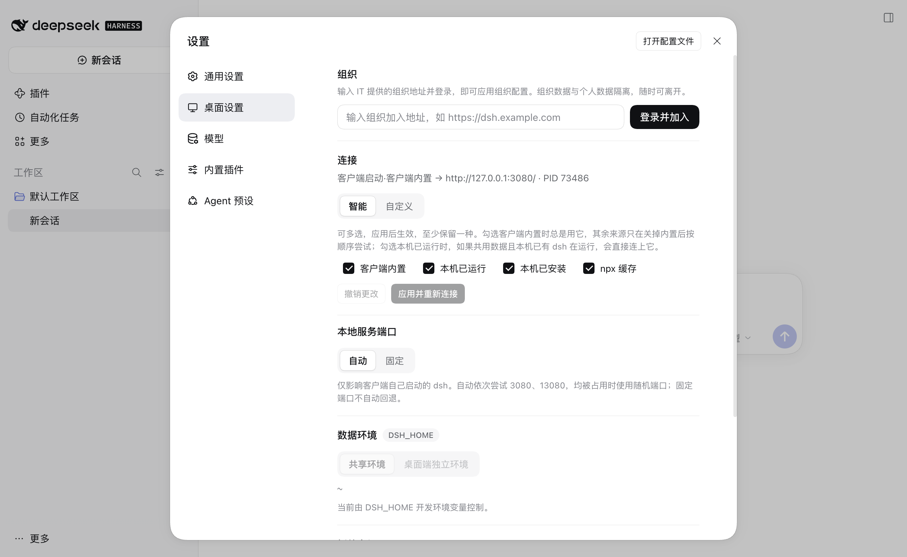
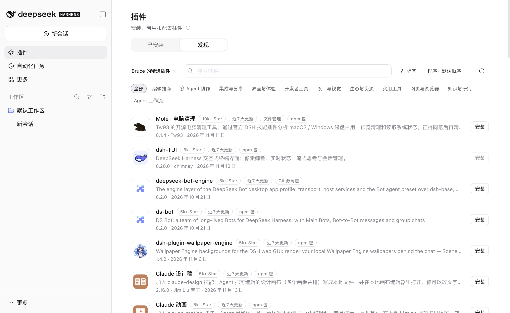

# DSH Desktop

[中文](README.md) | English

**A third-party DSH desktop client that uses the official Web UI and adds background operation, notifications, runtime selection, and a curated plugin index subscribed out of the box.**

DSH Desktop is an independent Electron client for DeepSeek Harness (`dsh`). It loads the official Web UI. The desktop client manages runtime startup and connection, the tray, notifications, updates, and security controls.

> [!IMPORTANT]
> **This is an unofficial community project.** It is not developed, published, endorsed, or supported by DeepSeek. `DeepSeek`, `DeepSeek Harness`, `dsh`, and related names and marks belong to their respective owners.

Release installers include a pinned version of the official `@deepseek-ai/dsh` runtime. Starting the client and using its bundled runtime requires no separate installation of Node.js, pnpm, or the `dsh` CLI. Individual tasks or plugins may still require additional tools. The desktop client and official runtime have separate version numbers, both shown in Connection settings.


## Main features

- Keeps running after the main window closes and reopens from the tray or menu bar. On Linux without a tray, launching the same AppImage again restores the window.
- Uses the official Web UI instead of maintaining a separate interface.
- Includes the official runtime in the installer.
- Can reuse a running dsh or use a PATH installation, npx cache, or the bundled runtime.
- Can share `~/.dsh` with the CLI or use an isolated desktop data environment.
- On first launch, turns on the official Custom plugin market and subscribes it to a curated plugin index. This happens once; a removed subscription is not added back.
- Verifies update packages with SHA-256 before installation.
- Uses Electron sandboxing, context isolation, navigation restrictions, and permission controls.

## Quick start

### Download a release

Download the installer for your system from [GitHub Releases](https://github.com/bruc3van/dsh-desktop/releases). Release builds already contain the official dsh runtime and do not run npm installation on first launch.

| Your device | Package to choose |
|---|---|
| macOS, Apple Silicon (Apple M series) | `mac-arm64.dmg` |
| macOS, Intel | `mac-x64.dmg` |
| Windows, 64-bit Intel/AMD | `win-x64.exe` |
| Linux, 64-bit Intel/AMD | `linux-x86_64.AppImage` |
| Ubuntu 24.04, 64-bit Intel/AMD installer | `linux-amd64.deb` |

These are filename suffixes; the full name also includes the client version. Platform availability depends on the assets of the selected Release. Linux build targets include x64 AppImage and DEB. DEB targets Ubuntu 24.04; ARM64 and RPM packages are not provided.

macOS/Windows packages do not yet have full developer signing and notarization, so the operating system may block the first launch.

**If the operating system blocks the first launch**

- **macOS:** Move the app to Applications and open it. Then go to **System Settings → Privacy & Security** and choose **Open Anyway**.

  If macOS reports that the app is damaged and does not show **Open Anyway**, run:

  ```sh
  xattr -dr com.apple.quarantine "/Applications/DSH Desktop.app"
  ```

- **Windows:** In Microsoft Defender SmartScreen, choose **More info**, then **Run anyway**.

### Install on Linux x64

**Ubuntu 24.04 installer (DEB):** Download the file ending in `linux-amd64.deb` and run `sudo apt install ./actual-filename.deb` from its folder. Open **DSH Desktop** from the application menu or run `dsh-desktop`. Installation sets up the launcher, icons and an application-scoped AppArmor profile; FUSE is not required. Quit the client before upgrading with the same command. `sudo apt remove dsh-desktop` removes the app while preserving settings and session data.

**Portable AppImage:**

1. Download the package whose filename ends in `linux-x86_64.AppImage`.
2. Place it in `~/Applications/` (create the directory if needed) and keep the original filename.
3. Allow execution in the file's properties, then double-click it. Alternatively, grant executable permission with:

   ```sh
   chmod +x ~/Applications/dsh-desktop-*-linux-x86_64.AppImage
   ```

If FUSE 2 is missing, Ubuntu 24.04 users can install `libfuse2t64`. Alternatively, pass `--appimage-extract-and-run` when launching the AppImage. If double-clicking opens no window, run the file from a terminal to see the error. For user-namespace or Chromium sandbox restrictions, follow the [Linux installation and system requirements](docs/development.md#linux-x64) to configure AppArmor. The client requires renderer sandboxing.

The current validation environment is Ubuntu 24.04 under WSL, with X11 and WSLg Wayland checks. Other distributions and full native GNOME/KDE desktop behavior need separate validation; the AppImage format does not establish compatibility with every Linux system. Tray integration, system notifications, and input methods depend on the desktop environment.

### Start a conversation

1. Enter an API key on first launch, or choose **Configure later**.
2. Create a key at <https://platform.deepseek.com/api_keys> if needed. DeepSeek manages the account, balance, and charges.
3. Choose an Agent preset or model if needed.
4. Add and select a project folder as the conversation's workspace.
5. Start a conversation and send the task.

> [!TIP]
> A fresh data directory may start in English. Change the language under **Settings → General → Language**.

## Connection modes

| Mode | Behavior |
|---|---|
| **Smart** (default) | Tries a running official instance, a `dsh` on PATH, an npx-cached package, then the bundled runtime. |
| **Custom** | Connects to a specified Web UI address without starting a local runtime. |

Smart mode uses only runtimes already on the machine. It does not download or install Node.js. Connection settings can disable individual sources, but at least one must remain. The isolated data environment does not reuse running instances from the shared environment, so an installed, npx-cached, or bundled runtime must remain enabled. Source changes are staged until **Apply and reconnect** is selected. Unapplied changes can be undone.

For local services, automatic port selection tries 3080, then 13080, then an OS-assigned port. A fixed port can also be configured. A fixed port does not change automatically when occupied.

In the shared data environment, if the client detects a running official instance but the current settings do not allow reuse, it refuses to start another process and does not stop the user-owned process. Stop that instance in the terminal first, or switch to the isolated data environment.

Open **Desktop settings** from the tray menu, the macOS/Linux application menu, or with `Cmd+,` on macOS and `Ctrl+,` on Windows/Linux.



Connection status values:

| Status | Meaning |
|---|---|
| Already running | Reuses a user-started instance |
| Client-started · bundled | Uses the runtime in the installer |
| Client-started · npx cache | Uses the npx-cached runtime |
| Client-started · installed | Uses the `dsh` on PATH |
| Custom address | Connects to an address without starting a runtime |

Client-started Web UIs use a loopback address. A Custom address can connect to a Web UI you manage; that deployment must provide authentication and network access. The client saves only the scheme, host, and port, dropping paths, query parameters, and fragments. For connections across machines, consult the [official documentation](https://github.com/deepseek-ai/deepseek-harness) for your runtime version.

See the [development guide](docs/development.md#run-from-source) for runtime selection, port, and authentication details.

## Data and security

| Data | Default location | Owner |
|---|---|---|
| Shared conversations, credentials, model settings, and plugins | `~/.dsh` | Official dsh |
| Desktop settings, command shims, and update downloads | `~/.bruc3van-dsh-desktop` | Desktop client |
| Isolated conversations, credentials, model settings, and plugins | `~/.bruc3van-dsh-desktop/dsh` | Official dsh |

The **Data environment** setting switches between Shared and an isolated desktop environment after restart. Switching does not copy conversations or plugins from the previous environment.

When the new directory does not exist, the client migrates legacy `~/.dsh-desktop` data to `~/.bruc3van-dsh-desktop`. If moving fails, it copies the data and leaves the old directory in place.

Security controls include:

- Starts services through the official `dsh web` CLI and interacts through the Web UI's `/api` interfaces. The one-time preset subscription calls the runtime's own profile initialisation and edits two settings in the web profile.
- Enables Electron sandboxing and context isolation and disables Node integration.
- Restricts navigation to the current Web UI origin and opens external links in the system browser.
- Ignores environment overrides for update sources, data directories, and connection probes in packaged builds by default, unless unsafe debugging is explicitly enabled.
- Validates update metadata and installer filenames and verifies installer SHA-256.
- Allows capabilities such as file picking and voice input for client-managed local Web UIs; reused instances and Custom addresses receive more restricted permissions. Cross-origin frames, USB/HID/serial, geolocation, display capture, and storage escalation are denied by default.
- The preset subscription only writes an index address. The plugin list is fetched only when you open the Discover page, and the client never installs a plugin for you.

Windows installers support system notifications. Linux uses Chromium notifications. Current macOS packages are not fully signed, so notifications fall back to Dock badges, Dock attention, and in-app notices.

Use of this client remains subject to the terms and privacy policies of DeepSeek, model providers, and connected services. Users and those services are responsible for API keys, requests, charges, generated content, and Agent actions on local files and commands.

## Desktop behavior

- Closing the main window keeps the app running; reopen it from the tray or menu bar. On Linux without a tray, launch the installed app or the same AppImage again to restore the window. Use **DSH Desktop → Quit** in the window menu or `Ctrl+Q` to exit.
- **Restart client** restarts client-managed local runtimes but does not stop a `dsh web` process started by the user.
- A local Web UI that exits unexpectedly receives a limited number of restart attempts.
- After system resume or a long idle, an invalid page reloads after the service becomes available.
- If a reused Smart-mode instance disappears, the client can try other enabled sources. A failed Custom address does not switch automatically.
- Uses runtime locks and local service probes to avoid starting duplicate runtimes on the same `DSH_HOME`. If it cannot safely adopt or stop an old process, it refuses to start a new one. These checks cannot stop users from launching additional instances through other terminals or tools.
- If plugins prevent Shared from starting, the user can remove the confirmed plugins and retry, or keep them and switch to the isolated environment.

Release builds check GitHub Releases after startup and do not repeat automatic checks within 12 hours. Manual checks are available from settings, the tray, and the macOS/Linux application menu.

The update window shows download, verification, and the next action. Failed downloads can be retried, and downloads can continue after the window closes.

On macOS, the client can replace and restart an app installed in a writable directory. It attempts to restore the previous app if replacement fails. Updates interrupt client-managed local tasks.

On Linux, updates download and verify the current package format (DEB or AppImage), then reveal the file. For DEB, quit the client and run `sudo apt install ./actual-filename.deb`; for AppImage, replace the original file. Tasks keep running during the download. Use **DSH Desktop → Quit** or `Ctrl+Q` to exit, finish installing the update for your package format, and reopen it. Closing the main window only hides it; it does not quit the client. Verified downloads remain reusable after a client restart.

## Bundled runtime environment

- When starting a local runtime, release builds generate `node`, `dsh`, and `pnpm` command wrappers under `~/.bruc3van-dsh-desktop/bin` and append that directory to the runtime's PATH, inherited by Agent commands. User tools already on PATH take priority; the client does not modify the system PATH.
- The `node` command uses Electron's bundled Node.js, and `pnpm` ships with the installer. The client does not bundle `npm` or `npx`. If those commands are needed, install a complete Node.js distribution that includes npm/npx and ensure they are available on the PATH of the client-started runtime.
- The bundled `dsh` wrapper supports plugin management, version queries, and configuration exports. It rejects commands that start another runtime instance, such as `dsh web`.
- At runtime startup, the client clears its internal `ELECTRON_RUN_AS_NODE` setting so ordinary Agent shell commands do not accidentally use Electron's Node mode.
- The app does not use the macOS App Sandbox. Electron's window sandbox is separate from any Agent command sandbox; Agent actions also depend on the runtime's permission policy, sandbox configuration, and operating-system grants.
- The bundled runtime ships with the client and cannot be upgraded separately.

See [Desktop client architecture](docs/desktop-client-architecture.md) and the [development guide](docs/development.md) for implementation details.

## Preset plugin subscription

Official DSH ships a Custom plugin market (the **Discover** tab on the Plugins page), but it is off by default and has no index sources. The first time the client starts a local runtime, it does two things for you:

1. turns on the Custom plugin market;
2. adds the index `https://bruc3van.com/dsh-plugins/index.json`.

You can then browse, filter, and install plugins under **Plugins** → **Discover**; installation is done by the official plugin manager.



The index comes from [awesome-dsh-plugin](https://github.com/bruc3van/awesome-dsh-plugin): repositories tagged `dsh-plugin` are collected daily, archived, disabled, and ineligible projects are excluded, and the top 1000 by stars are listed. **Being listed is not a security endorsement; review the source and permissions before installing.**

Rules:

- **Added once.** Once per data environment (the shared `~/.dsh` and the desktop-only environment). If you remove the subscription or turn the Custom plugin market off, the client does not add it back.
- **Your configuration wins.** If the profile already configures the Custom plugin market, the client changes nothing.
- **Only for runtimes the client starts.** Reusing a running local instance or connecting to a Custom address leaves that service's configuration alone.
- The edits are the bundle list in `~/.dsh/profiles/web/package.json` and one commented block appended to `cordis.patch.yml`; existing content and comments are kept as they are.

**Upgrading from an earlier version:** from 0.6.0 the installer no longer bundles safer-dsh-market. A copy that is already installed stays in your profile, but the client no longer updates it; uninstall it from the Plugins page if you do not need it. For features such as AI review after installation, install [safer-dsh-market](https://github.com/bruc3van/safer-dsh-market) from npm yourself.

## FAQ

**Q: Is this a browser wrapper?**

The window loads the official Web UI, but the client also manages runtimes, connections, the tray, notifications, permissions, and updates. It does not maintain a separate product interface. See the [architecture document](docs/desktop-client-architecture.md).

**Q: How is this different from opening the Web UI in a browser?**

The browser workflow normally requires Node.js, a running `dsh web` terminal process, and manual browser access. The desktop client includes a runtime, manages it in the background, and provides tray controls, notifications, connection settings, and in-app updates.

**Q: How can I use the latest official dsh?**

Update the official `dsh` on PATH or the npx-cached runtime and enable that source in Smart mode. You can also reuse an updated local instance or connect to a Web UI you manage through a Custom address. Smart mode follows source order; it does not compare every source and select the newest version. The bundled runtime is fixed at release time and is updated with the desktop client.

**Q: Does the preset subscription install plugins automatically?**

No. The client only adds the index address. Whether and what to install is your choice on the Discover page, and installation is done by the official plugin manager.

## Related projects

- [awesome-dsh-plugin](https://github.com/bruc3van/awesome-dsh-plugin): source of the preset index. It collects plugin repositories daily and maintains exclusion records.
- [safer-dsh-market](https://github.com/bruc3van/safer-dsh-market): a standalone review-before-install market plugin you can install yourself.
- [deepseek-harness](https://github.com/deepseek-ai/deepseek-harness): the upstream project for the official dsh and Web UI.

## License

[Apache-2.0](LICENSE)

From 0.6.0 this repository is licensed under the Apache License 2.0; releases up to and including 0.5.29 remain under the MIT License. The license covers only code and assets maintained in this repository. Official `@deepseek-ai/dsh` and other third-party dependencies use their own licenses. “DSH” identifies the compatible product and does not imply an official relationship.
