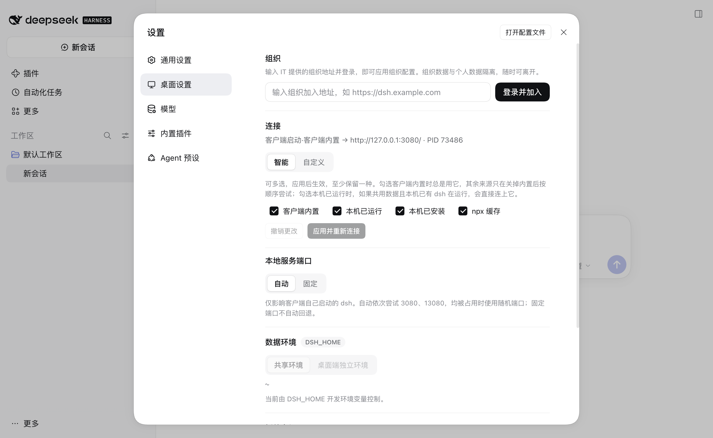
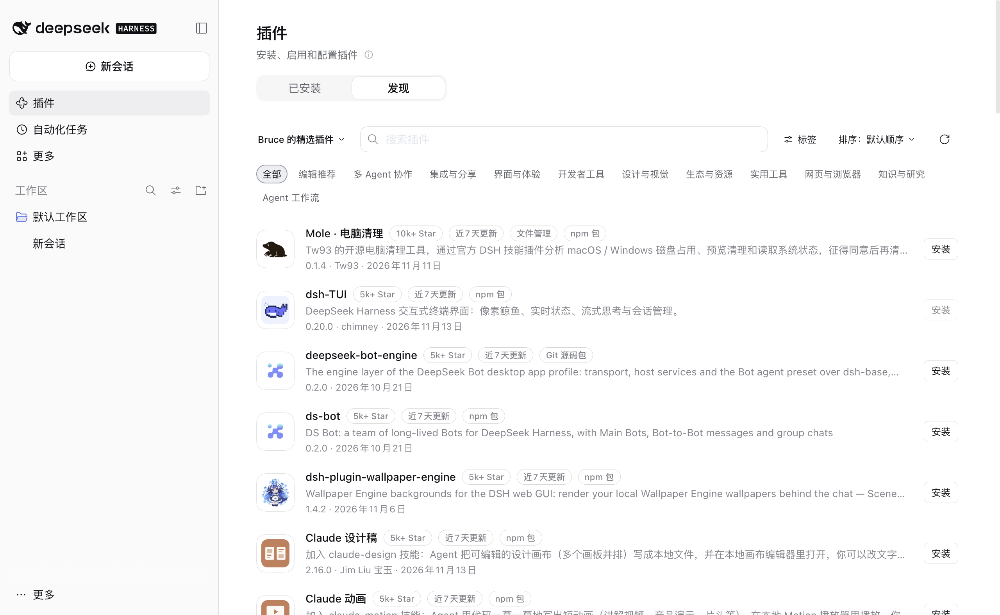

# DSH Desktop Pro 使用指南

中文 | [English](user-guide.md)

本文收录桌面客户端的详细行为：Linux 安装、连接方式、数据与安全、后台运行与更新、内置运行环境和预置插件订阅。产品介绍与下载见 [README](../README.md)；企业部署见[企业部署指南](enterprise.zh.md)。

## Linux x64 安装

**Ubuntu 24.04 安装版（DEB）**：下载 `linux-amd64.deb` 结尾的包，在下载目录执行 `sudo apt install ./实际文件名.deb`，然后从应用菜单打开 **DSH Desktop Pro**，或运行 `dsh-desktop`。安装会设置菜单、图标及限定应用路径的 AppArmor 策略，不需要 FUSE。升级前请使用“退出”结束客户端，再执行同一安装命令；`sudo apt remove dsh-desktop` 卸载应用并保留用户设置及会话数据。

**AppImage 便携版**：

1. 下载文件名以 `linux-x86_64.AppImage` 结尾的包。
2. 将文件放到 `~/Applications/`（目录不存在时先创建），保留原文件名。
3. 在文件属性中允许执行，然后双击打开。也可用以下命令赋予执行权限：

   ```sh
   chmod +x ~/Applications/dsh-desktop-pro-*-linux-x86_64.AppImage
   ```

缺少 FUSE 2 时，Ubuntu 24.04 可安装 `libfuse2t64`；也可在启动 AppImage 时加上 `--appimage-extract-and-run` 解压运行。若双击后没有窗口，请从终端运行该文件查看错误；遇到用户命名空间或 Chromium 沙箱限制时，按[Linux 安装与系统要求](development.zh.md#linux-x64)配置 AppArmor。客户端要求保留渲染器沙箱。

当前验证环境为 WSL 中的 Ubuntu 24.04，已检查 X11 和 WSLg Wayland。其他发行版及完整原生 GNOME/KDE 桌面仍需独立验证；AppImage 格式不代表所有 Linux 系统均已验证兼容。托盘、系统通知和中文输入法的实际表现取决于桌面环境。

## 连接方式

| 模式 | 行为 |
|---|---|
| **智能模式**（默认） | 按顺序尝试：正在运行的官方实例 → PATH 上的 `dsh` → npx 缓存 → 内置运行时。 |
| **自定义** | 连接指定的 Web UI 地址，不启动本地运行时。 |

智能模式只使用本机已有的运行时，不下载或安装 Node.js。连接设置可关闭任一来源，但至少保留一种。独立数据环境不复用共享环境中已运行的实例，需保留本机已安装、npx 缓存或内置运行时之一。来源选择先暂存，点击“应用并重新连接”后生效；也可撤销未应用的更改。

客户端启动本地服务时，自动尝试 3080、13080，再使用系统分配的端口。也可以设置固定端口。固定端口被占用时不会自动换端口。

共享数据环境下，如果客户端检测到官方实例仍在运行，但当前设置不允许复用，会拒绝另起进程，也不会结束用户启动的进程。请先在终端停止该实例，或切换到独立数据环境。

可从托盘菜单、macOS/Linux 应用菜单或主窗口快捷键打开“桌面设置”：macOS 使用 `Cmd+,`，Windows/Linux 使用 `Ctrl+,`。



连接状态说明：

| 状态 | 含义 |
|---|---|
| 本机已运行 | 复用用户启动的实例 |
| 客户端启动·客户端内置 | 使用安装包内置运行时 |
| 客户端启动·npx 缓存 | 使用 npx 缓存运行时 |
| 客户端启动·本机已安装 | 使用 PATH 上的 `dsh` |
| 自定义地址 | 连接指定地址，不启动运行时 |

客户端启动的 Web UI 使用本机回环地址。自定义地址可连接自行维护的 Web UI，认证和网络可达性需由该部署保证；地址按协议、主机和端口保存，不保留路径、查询参数或片段。跨机器连接的部署方式请参照所用版本的[官方文档](https://github.com/deepseek-ai/deepseek-harness)。

运行时选择、端口和认证细节见[开发指南](development.zh.md#从源码运行)。

## 数据与安全

| 数据 | 默认位置 | 管理方 |
|---|---|---|
| 共享环境的会话、凭据、模型配置和插件 | `~/.dsh` | 官方 dsh |
| 桌面端设置、命令 shim 和更新下载 | `~/.bruc3van-dsh-desktop` | 桌面客户端 |
| 独立环境的会话、凭据、模型配置和插件 | `~/.bruc3van-dsh-desktop/dsh` | 官方 dsh |

设置中的“数据环境”可以在共享环境和桌面端独立环境之间切换，重启后生效。切换不会复制原环境中的会话或插件。

旧版 `~/.dsh-desktop` 会在新目录不存在时迁移到 `~/.bruc3van-dsh-desktop`。移动失败时会复制数据并保留旧目录。

主要安全措施：

- 通过官方 `dsh web` CLI 启动服务，通过 Web UI 的 `/api` 接口交互；首次预置插件订阅时，会调用运行时自己的 profile 初始化，并修改 web profile 中的两处配置。
- Electron 启用沙箱和上下文隔离，关闭 Node 集成。
- 页面导航限制在当前 Web UI 源站，外部链接使用系统浏览器打开。
- 打包版本默认忽略覆盖更新源、数据目录或连接探测设置的环境变量；显式启用不安全调试模式时例外。
- 更新清单和安装包文件名会进行校验，安装包会校验 SHA-256。
- 客户端管理的本机 Web UI 可使用文件选择、语音输入等权限；复用的实例和自定义地址采用更受限的权限策略。跨域子框架、USB/HID/串口、定位、屏幕捕获和存储权限升级默认拒绝。
- 预置订阅只写入订阅地址。只有打开「发现」页时，才会联网读取插件列表；客户端不会替你安装任何插件。

Windows 安装版支持系统通知。Linux 使用 Chromium 通知。当前 macOS 包没有正式签名，因此系统通知会降级为 Dock 角标、Dock 弹跳和应用内提醒。

使用本客户端仍需遵守 DeepSeek、模型提供方和所连接服务的条款与隐私政策。API Key、模型请求、费用、生成内容以及 Agent 对本机文件和命令的操作由用户和对应服务负责。

## 桌面端行为

- 关闭主窗口后继续后台运行；从托盘或菜单栏可重新打开。Linux 无托盘时，再次从应用菜单启动或打开同一 AppImage 可恢复窗口；使用窗口菜单“DSH Desktop Pro → 退出”或 `Ctrl+Q` 结束客户端。
- “重启客户端”会重启客户端管理的本地运行时，不会结束用户在终端启动的 `dsh web`。
- 本地 Web UI 意外退出时会进行有限次数的重启。
- 系统唤醒或长时间后台运行后，页面异常时会在服务可用后重新加载。
- 智能模式复用的实例失联时，可回退到其他已启用来源。自定义地址失败时不会自动切换。
- 客户端通过运行时锁和本机服务探测，避免为同一 `DSH_HOME` 重复启动运行时。无法安全接管或停止旧进程时，会拒绝启动新进程；这些检查不能阻止用户从其他终端或工具启动额外实例。
- 共享环境因插件失败而无法启动时，可卸载确认存在的问题插件后重试，或保留插件并切换到独立环境。

发布版启动后会检查 GitHub Releases，12 小时内不重复自动检查。也可从设置、托盘菜单或 macOS/Linux 应用菜单手动检查。更新窗口显示下载、校验和后续操作；下载失败可重试，关闭窗口后下载可以继续。

macOS 可在应用目录可写时自动替换并重启应用。更新失败时会尝试恢复旧应用。更新会中断客户端管理的本地任务，请选择合适的时间执行。

Linux 更新会按当前安装格式下载并校验 DEB 或 AppImage，然后打开文件位置；DEB 请在退出客户端后用 `sudo apt install ./实际文件名.deb` 安装新版，AppImage 则手动替换原文件；下载期间任务继续运行。请通过“DSH Desktop Pro → 退出”或 `Ctrl+Q` 退出客户端，再按安装格式完成更新并重新打开。关闭主窗口仅隐藏窗口，不能代替退出。已校验的下载在客户端重启后仍可复用。

## 内置运行环境

- 发布版在启动本地运行时时，于 `~/.bruc3van-dsh-desktop/bin` 生成 `node`、`dsh` 和 `pnpm` 命令入口，并将该目录追加到运行时及其 Agent 命令的 PATH。已有 PATH 中的用户工具优先；客户端不修改系统 PATH。
- `node` 使用 Electron 自带的 Node.js 执行能力，`pnpm` 随安装包提供；客户端未内置 `npm` 和 `npx`。如需使用这两个命令，请另行安装包含 npm/npx 的完整 Node.js 发行版，并确保命令在客户端启动的运行时 PATH 中可用。
- 内置 `dsh` 入口支持插件管理、版本查询和配置导出，会拒绝再次启动 `dsh web` 等运行时实例。
- 客户端启动运行时时会清理内部的 `ELECTRON_RUN_AS_NODE` 设置，避免普通 Agent shell 命令误用 Electron 的 Node 模式。
- 应用未启用 macOS App Sandbox。Electron 窗口沙箱不等同于 Agent 命令沙箱；Agent 操作还受所用运行时的权限策略、沙箱配置和操作系统授权约束。
- 内置运行时随客户端发布，不能单独升级。

实现细节见[桌面客户端架构](desktop-client-architecture.zh.md)和[开发指南](development.zh.md)。

## 预置插件订阅

官方 DSH 自带「自定义插件市场」（插件页的「发现」标签），但默认关闭，也没有任何订阅源。客户端第一次启动本地运行时，会替你做两件事：

1. 打开「自定义插件市场」；
2. 添加订阅地址 `https://bruc3van.com/dsh-plugins/index.json`。

之后在左侧 **插件** → **发现** 里就能直接浏览、筛选、安装插件，安装由官方插件管理器完成。



这份列表来自 [awesome-dsh-plugin-pro](https://github.com/bruc3van/awesome-dsh-plugin-pro)：每日采集带 `dsh-plugin` 标签的仓库，由维护者核实收录条件，排除已归档、停用和不符合条件的项目，按 Star 排序发布精选订阅；数量随数据源更新。**收录不代表安全背书，安装前请自行查看源码和权限。**

规则：

- **只添加一次。** 每个数据环境（共享的 `~/.dsh` 和桌面端独立环境）各添加一次。你删掉订阅或关掉自定义插件市场后，客户端不会再加回来。
- **不覆盖你的配置。** 如果 profile 里已经配置过自定义插件市场，客户端什么都不改。
- **只在客户端自己启动运行时时生效。** 复用已在运行的本机实例或连接自定义地址时，不改动对方的配置。
- 改动的是 `~/.dsh/profiles/web/package.json` 中的组合包列表，以及 `cordis.patch.yml` 中追加的一段带注释的配置；原有内容和注释原样保留。

**从旧版本升级：** 安装包从 0.6.2 / 0.7.0-beta.5 起重新内置插件市场，换成 [DSH Market Pro](https://github.com/bruc3van/dsh-market-pro)（`dsh-market-pro@1.0.4`），由客户端启动本地服务时自动装进 web profile 并启用，客户端升级时一并更新。以前客户端装上的旧版市场 `safer-dsh-market` 会被自动移除；自己装的那份会保留，但它在的时候 DSH Market Pro 不会加载，请先在插件页卸载它。不想要内置市场，可以在「桌面设置 → 数据环境 → 插件市场」里关掉，下次由客户端启动本地服务时移除客户端装的那份。
